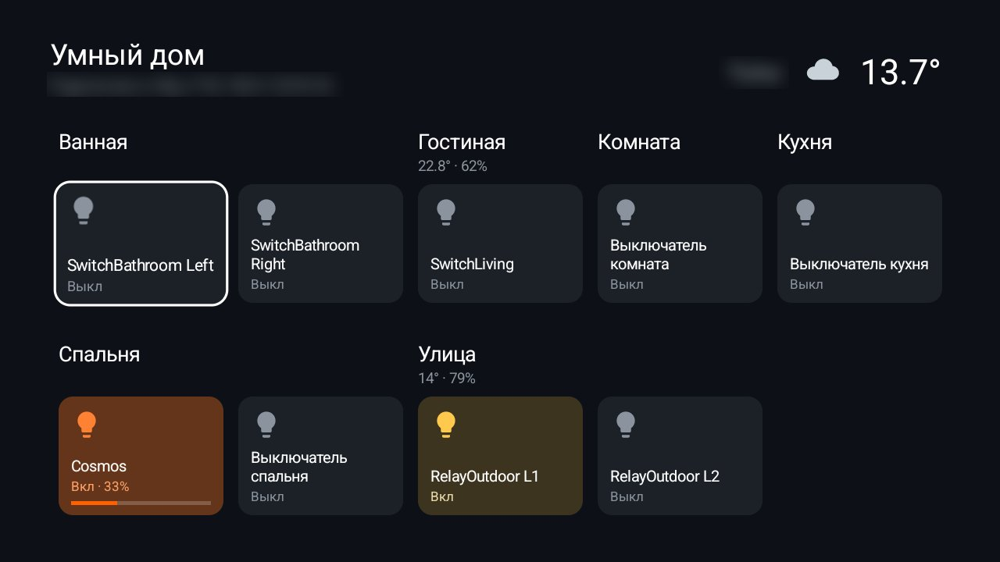

# Smart Home

Your [Home Assistant](https://www.home-assistant.io) on the TV: the home's name and the weather at the top, then
your devices as tiles grouped by room (Home Assistant's areas), with each room's temperature and humidity beside
its name. OK switches a light or runs a scene; holding OK on a light opens its brightness and, for an RGB light,
its colours; CH+ / CH- change a light's brightness at once. A **More** row at the bottom opens pending updates and
the connection settings. A community add-on, not made by or affiliated with the Home Assistant project. For
the [Clean Your TV](../../README.md) launcher it declares a [module card](../../docs/modules.md): once you answer
**Show card** its tile reads "Smart Home" with a blue glow. On any other Android TV home it is an ordinary app.



### Rooms and tiles

The tiles come from `GET /api/states`; the room of each entity comes from Home Assistant's areas, read once per
opening through `POST /api/template` (`area_name()`). Small rooms share a row of five, a large one wraps. A tile
that is on glows warm, or in an RGB light's current colour (`rgb_color`, colour mode on); a dimmable light shows a
brightness bar. The room's temperature and humidity sensors go into its header (`22.1° · 63%`); entities without
an area are under **Other**. When the areas can't be read, the screen falls back to the list by kind below.

| On a tile | Does |
|---|---|
| OK | Switches it (`homeassistant.toggle`), runs a scene |
| Hold OK on a light | Brightness slider (◀ ▶ by 10 %) and, for an RGB light, two rows of twelve colours; ▼ lands on the one nearest the lamp's colour, OK sets it (`rgb_color`, or the light's own `white` mode for white) |
| CH+ / CH- | Brightness ±10 % (`brightness_step_pct`), or the set temperature of a thermostat |

The list scrolls under the header and fades out there. The header shows Home Assistant's `location_name`
(`GET /api/config`) left of the weather.

### More: updates and connection

The **More** row carries a red badge with the number of pending updates (`update.*` entities in state `on`). It
opens a second screen: each update with its installed and latest version, and the connection rows. OK on an update
asks first, with Cancel focused, then calls `update.install`, with `backup: true` where the entity supports a
backup (add-ons do, device firmware usually doesn't, and the dialog says so). Progress shows from `in_progress` /
`update_percentage`. Back returns to the rooms.

### Plain list by kind

| Section | Shows | With the remote |
|---|---|---|
| Glance | `weather.*` temperature and condition icon; sensors whose unit is `€`, `EUR`, `€/L` or `EUR/L` (Tankerkönig and the like) | Shown only |
| Scenes | `scene.*` | OK runs it |
| Lights and switches | `light.*`, `switch.*`, `fan.*`, `input_boolean.*`, on or off with brightness | OK toggles, ◀ ▶ dims a light |
| Climate | `climate.*`: room temperature → set temperature | ◀ ▶ moves the set temperature |
| Sensors | `sensor.*` with device class temperature or humidity | Shown only |
| Doors and windows | `binary_sensor.*` with device class door, window, garage door or opening | Shown only |
| Locks | `lock.*`, locked or unlocked | **Shown only: a TV remote never unlocks a door** |

At most 80 entities, sorted by name within each section; unavailable ones are dimmed. The glance header takes the
first available weather entity and up to six fuel-price sensors unless you name the entities in the config (below).
It reads `GET /api/states` every 10 seconds while the screen is open, and nothing when it is closed.

## Setup

You need the server's address (for example `http://192.168.1.10:8123`) and a long-lived access token: in Home
Assistant, open your profile, then Security, then Long-lived access tokens, Create token. Then either:

- open the app and fill in **Home Assistant address** and **Access token** with the TV's keyboard (or the phone
  remote's), or
- put both in a file and push it from a computer, so the token is never typed on the TV or put on a command line:

  ```bash
  echo '{"url": "http://192.168.1.10:8123", "token": "eyJ...", "glance": ["weather.home", "sensor.station_e10", "sensor.station_diesel"]}' > backup/smart-home.json
  TV_HOST=<tv ip> addons/smart-home/install.sh backup/smart-home.json
  ```

  `glance` is optional: without it the app picks the first weather entity and up to six euro fuel-price sensors.
  Three more optional keys trim the screen:

  | Key | Does |
  |---|---|
  | `exclude` | entity_id patterns not to show, `*` for any characters, ignoring case: `["*_power_outage_memory", "*_flip_indicator_light", "switch.*_child_lock", "*robot_vacuum*"]`. Devices expose many configuration switches; this keeps the tiles to what you switch. Updates are never excluded. |
  | `hide_unavailable` | `true` hides devices that are `unavailable` or `unknown` (an unplugged lamp) until they come back; the screen refreshes every 10 seconds. |
  | `no_install` | update entity patterns that are shown but can't be installed from the TV, for an update you'd rather run at the computer. |

  The app takes the file into its own storage and deletes it. Keep the file outside the repo (`backup/` is
  git-ignored).

## Permissions

| Permission | Why |
|---|---|
| `INTERNET` | Your Home Assistant server, and nothing else: no telemetry, no update checks, no ads. |

Plain `http://` is allowed for the home network (`res/xml/network.xml`); use `https://` with a certificate from a
public authority (Nabu Casa, Let's Encrypt). The token stays in the app's own storage (backups are off) and is
sent only to the address you entered, as `Authorization: Bearer`. `ConfigProvider` takes a pushed file and only
the ADB shell can use it (it requires `WRITE_SECURE_SETTINGS`, as Frigate Glance's does). No foreground service,
accounts or libraries.

## Build and install

JDK 17 and Android SDK platform 34 with build-tools 34.0.0, as for the launcher:

```bash
TV_HOST=<tv ip> addons/smart-home/install.sh [config.json]
```

To build only: `cd addons/smart-home && ./gradlew assembleRelease`; the JVM tests run with
`./gradlew testReleaseUnitTest`.

A new `screenshot.jpg` from a real TV (16:9, under 300 KB, address and token blurred) belongs with any visual
change to the glance header.

## Limits

- **Self-signed HTTPS** certificates are refused. Use `http://` on the home network or a public certificate.
- **`homeassistant.local`** names only resolve where the TV's network does mDNS name lookups; use the IP address
  if it doesn't.
- **Which entities** is fixed by domain and device class, trimmed with `exclude`; the glance list can be named in
  `config.json`. There is no on-TV picker yet.
- **Home Assistant notifications and repairs** are not counted in the More badge: the REST API doesn't offer them
  (they need the WebSocket API).

## Languages

English, and Russian (`values-ru`). The words for states, sections and errors in the JVM-tested `Ha` class go
through `Ha.Lang`; `Ha.ENGLISH` is what the tests read and `Texts` gives the app's string resources.

## Tested on

MOKA R8G (Android 14), on a home app that implements the module-card spec, against a stand-in server on the home network answering with Home Assistant's documented response shapes: the config pushed through `ConfigProvider`, reading the states, running a scene and dimming a light (the requests arrived as the REST API documents them). The screenshot shows the glance header on the Sony BRAVIA, with the address blurred. Also tried on a Sony BRAVIA (Android 9) against a real Home Assistant: weather and a euro fuel-price sensor on the glance header (with unit). The JVM tests cover parsing, the service calls, the request headers against a local stand-in, and errors.

Rooms, tiles, RGB colours, updates, the filters and the Russian translation: TCL G13 (Google TV 14) and TCL
BeyondTV (Android TV 11), against a real Home Assistant 2026.10 with Zigbee lights, relays and sockets, an RGB
light and five pending updates; the owner updated Mosquitto from the TV, with a backup. The JVM tests cover the areas, rooms,
filters, colours, updates and install calls.

## Maintainer

[@maxhayim](https://github.com/maxhayim)
